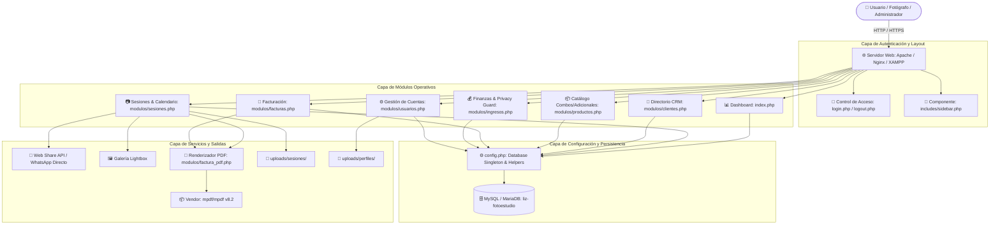
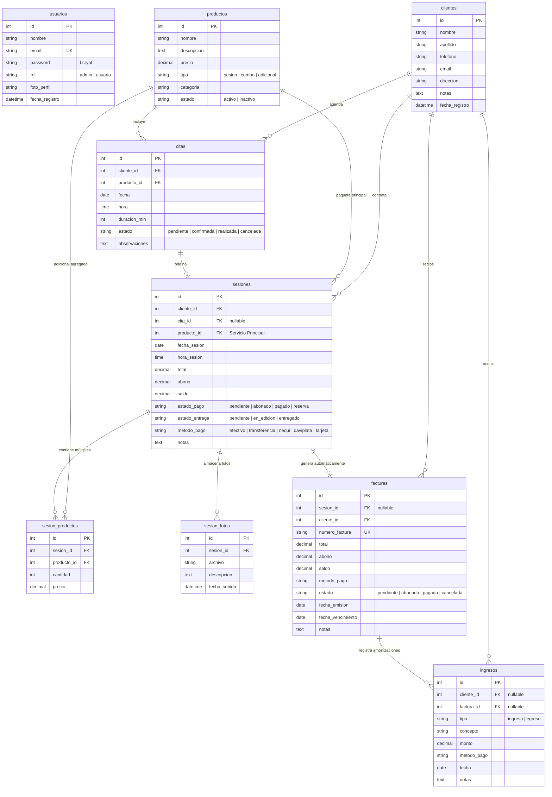
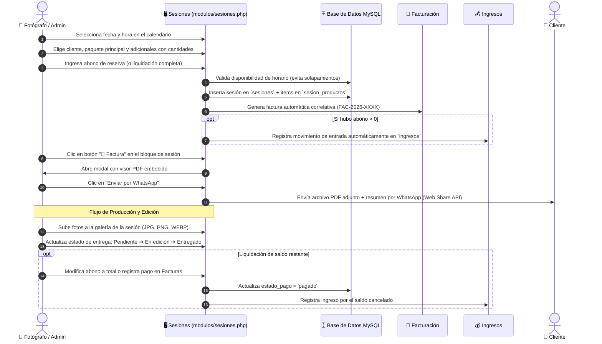
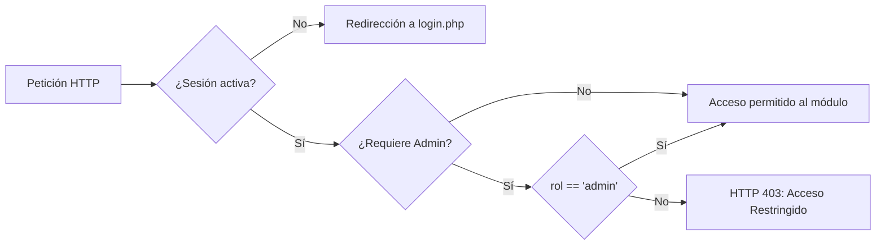

# 📸 Lizdy Pineda Fotoestudio – Sistema Web de Gestión

> [!abstract] Resumen del Sistema
> Sistema web integral de gestión administrativa, comercial y operativa desarrollado a medida para **Lizdy Pineda Fotoestudio**. Centraliza la administración de clientes (CRM), agendamiento de sesiones con calendario y control de franjas horarias, paquetes fotográficos con soporte de adicionales por sesión, galería multimedia con visualizador lightbox, facturación automática con renderizado PDF de alta fidelidad (**mPDF**) y envío directo por **WhatsApp**, panel financiero con telón de privacidad y análisis comparativo de ingresos/egresos, y control de acceso basado en roles (**RBAC**).

---

## 📑 Tabla de Contenido
- [📸 Lizdy Pineda Fotoestudio – Sistema Web de Gestión](#-lizdy-pineda-fotoestudio--sistema-web-de-gestión)
  - [📑 Tabla de Contenido](#-tabla-de-contenido)
  - [✨ Características Principales](#-características-principales)
  - [🏗️ Arquitectura y Tecnologías](#️-arquitectura-y-tecnologías)
  - [🗄️ Modelo de Base de Datos](#️-modelo-de-base-de-datos)
    - [Diagrama Entidad-Relación (ERD)](#diagrama-entidad-relación-erd)
    - [Diccionario de Datos](#diccionario-de-datos)
  - [🔄 Flujo Operativo del Negocio](#-flujo-operativo-del-negocio)
  - [🧩 Módulos del Sistema](#-módulos-del-sistema)
    - [1. Dashboard Central (`index.php`)](#1-dashboard-central-indexphp)
    - [2. Módulo de Sesiones y Calendario (`modulos/sesiones.php`)](#2-módulo-de-sesiones-y-calendario-modulossesionesphp)
    - [3. Módulo de Clientes (CRM) (`modulos/clientes.php`)](#3-módulo-de-clientes-crm-modulosclientesphp)
    - [4. Catálogo de Productos y Combos (`modulos/productos.php`)](#4-catálogo-de-productos-y-combos-modulosproductosphp)
    - [5. Módulo de Facturación y PDF (`modulos/facturas.php` \& `modulos/factura_pdf.php`)](#5-módulo-de-facturación-y-pdf-modulosfacturasphp--modulosfactura_pdfphp)
    - [6. Panel de Ingresos y Finanzas (`modulos/ingresos.php`)](#6-panel-de-ingresos-y-finanzas-modulosingresosphp)
    - [7. Módulo de Usuarios y Seguridad (`modulos/usuarios.php` \& `login.php`)](#7-módulo-de-usuarios-y-seguridad-modulosusuariosphp--loginphp)
    - [8. Componente Transversal: Sidebar (`includes/sidebar.php`)](#8-componente-transversal-sidebar-includessidebarphp)
  - [📂 Estructura del Repositorio](#-estructura-del-repositorio)
  - [🚀 Guía de Instalación y Despliegue](#-guía-de-instalación-y-despliegue)
    - [Requisitos del Sistema](#requisitos-del-sistema)
    - [Paso 1: Clonar o ubicar el proyecto](#paso-1-clonar-o-ubicar-el-proyecto)
    - [Paso 2: Instalación de dependencias de Composer](#paso-2-instalación-de-dependencias-de-composer)
    - [Paso 3: Crear la Base de Datos y Tablas](#paso-3-crear-la-base-de-datos-y-tablas)
    - [Paso 4: Configuración del Entorno (`config.php`)](#paso-4-configuración-del-entorno-configphp)
    - [Paso 5: Permisos de Directorios de Almacenamiento](#paso-5-permisos-de-directorios-de-almacenamiento)
  - [🔐 Seguridad y Roles (RBAC)](#-seguridad-y-roles-rbac)
  - [🎨 Sistema de Diseño (UI/UX)](#-sistema-de-diseño-uiux)
  - [📌 Enlaces Relacionados](#-enlaces-relacionados)

---

## ✨ Características Principales

- **Calendario Operativo y Franjas Horarias en Sesiones**:
  - Navegación mensual y diaria con marcadores de estado por colores.
  - Vista horaria estructurada (08:00 a 20:00 y horarios especiales) con prevención de choques de agenda.
  - Registro de paquete principal y múltiples productos adicionales con cálculo dinámico en tiempo real.
  - Visualización inmediata de notas y observaciones en cada bloque de sesión.
  - Visor integrado de factura PDF dentro de un modal en la misma pantalla.
  - Compartición directa de la factura por **WhatsApp** mediante la API nativa `navigator.share` (con archivo PDF adjunto y mensaje personalizado) o portapapeles.
  - Galería fotográfica integrada por sesión con carga de múltiples imágenes y previsualizador lightbox.
- **Panel de Control (Dashboard) Inteligente**:
  - Métricas en tiempo real: clientes registrados, sesiones por entregar, sesiones sin cobrar (con saldo acumulado), ingresos del mes y próximas sesiones agendadas.
  - Alertas proactivas segmentadas por pestañas: cobros pendientes, entregas de fotos atrasadas y citas próximas.
  - Enlace directo con auto-scroll y animación pulsante hacia la sesión seleccionada desde el Dashboard.
  - Ocultación y desenfoque de montos y gráficas financieras con botón de visibilidad tipo ojo para proteger la confidencialidad en pantallas visibles.
- **Directorio de Clientes (CRM) con Historial**:
  - Búsqueda instantánea por nombre, teléfono o email.
  - Modal de historial de sesiones por cliente vía AJAX con acceso directo al calendario.
- **Catálogo de Servicios, Combos y Adicionales**:
  - Clasificación diferenciada entre sesiones, combos y productos adicionales.
  - Categorías aisladas por tipo para evitar mezclas en las sugerencias del formulario.
  - Control de tarifas, descripciones y activación rápida de catálogo.
- **Facturación Automatizada & Sincronización Bidireccional**:
  - Generación automática de comprobantes correlativos (`FAC-YYYY-NNNN`) al agendar una sesión.
  - Amortización y registro de abonos con actualización simultánea en la sesión, la factura y el libro contable de ingresos.
  - Generador de comprobantes comerciales PDF con **mPDF v8.2**, compatible con visualización embebida (`?ver=1`) y descarga forzada.
- **Control Financiero con Telón de Privacidad (Privacy Guard)**:
  - Exclusivo para usuarios con rol `admin`.
  - Telón de desenfoque de pantalla al ingresar al módulo que requiere confirmación explícita para revelar cifras contables.
  - Botón en barra superior para re-bloquear la pantalla en cualquier momento.
  - Gráfica interactiva con alternancia entre vistas: mes actual, últimos 7 días y comparativa anual de todos los meses (Ingresos vs. Egresos).
- **Seguridad y Control de Acceso (RBAC)**:
  - Cifrado seguro de credenciales con `password_hash()` (bcrypt).
  - Sanitización estricta de entradas y consultas preparadas con `mysqli`.
  - Gestión de perfiles y avatares fotográficos para administradores y fotógrafos/operadores.

---

## 🏗️ Arquitectura y Tecnologías

El sistema adopta una arquitectura modular en **PHP nativo**, con patrón **Singleton** para la capa de acceso a base de datos, maquetación basada en **Tokens CSS** y componentes interactivos en **JavaScript Vanilla** (sin frameworks pesados externos).



### Tecnologías Empleadas

| Área | Tecnología | Propósito |
| :--- | :--- | :--- |
| **Backend** | PHP 8.0+ | Lógica de negocio, controladores modulares y sesiones seguras. |
| **Base de Datos** | MySQL 5.7+ / MariaDB 10.3+ | Motor relacional con integridad referencial (`mysqli`). |
| **Generación PDF** | mPDF v8.2 (Composer) | Renderizado HTML a PDF de alta resolución con fuentes personalizadas. |
| **Frontend** | HTML5 Semántico + Vanilla JS | Interactividad sin librerías pesadas, fetch asíncrono para galerías e historiales. |
| **Estilos** | CSS3 Vanilla (Tokens & Custom Properties) | Diseño responsivo, efectos glassmorphism, temas de color y transiciones. |
| **Tipografía** | Dancing Script & Nunito (Google Fonts) | Identidad visual estética adaptada al rubro de fotografía de autor. |

---

## 🗄️ Modelo de Base de Datos

### Diagrama Entidad-Relación (ERD)



### Diccionario de Datos

| Tabla | Propósito | Llaves Foráneas / Relaciones |
| :--- | :--- | :--- |
| `usuarios` | Cuentas de usuario con rol (`admin` o `usuario`), foto de perfil y hash bcrypt. | — |
| `clientes` | Directorio de clientes con teléfonos, correos y notas de seguimiento. | — |
| `productos` | Catálogo de servicios (`sesion`, `combo`, `adicional`), categorizados y tarifados. | — |
| `citas` | Registro histórico y reservaciones agendadas de clientes. | `cliente_id` ➔ `clientes.id`<br>`producto_id` ➔ `productos.id` |
| `sesiones` | Entidad operativa central: control de fecha, hora, entrega, totales y abonos. | `cliente_id` ➔ `clientes.id`<br>`producto_id` ➔ `productos.id` |
| `sesion_productos` | Tabla asociativa que almacena los productos adicionales y sus cantidades por sesión. | `sesion_id` ➔ `sesiones.id`<br>`producto_id` ➔ `productos.id` |
| `sesion_fotos` | Archivos de imágenes subidos para muestras y entregables de cada sesión. | `sesion_id` ➔ `sesiones.id` |
| `facturas` | Comprobantes de pago oficiales correlativos (`FAC-YYYY-NNNN`) vinculados a sesiones. | `sesion_id` ➔ `sesiones.id`<br>`cliente_id` ➔ `clientes.id` |
| `ingresos` | Libro contable unificado de entradas (abonos/pagos de facturas) y salidas operativas. | `cliente_id` ➔ `clientes.id`<br>`factura_id` ➔ `facturas.id` |

---

## 🔄 Flujo Operativo del Negocio



---

## 🧩 Módulos del Sistema

### 1. Dashboard Central (`index.php`)
- **Indicadores Numéricos (KPIs)**:
  - Total de Clientes registrados.
  - Sesiones pendientes de entrega fotográfica.
  - Sesiones sin cobrar y valor monetario total en deuda.
  - Total de ingresos acumulados en el mes en curso (con botón de privacidad para ocultar/mostrar cifras con un clic).
  - Próximas sesiones agendadas por realizar.
- **Alertas Proactivas en Pestañas**:
  - **Por cobrar**: Lista clientes con saldo en deuda, fecha de sesión y botón `Ver →` con auto-scroll animado hacia la sesión en el calendario.
  - **Entregas**: Sesiones en producción que requieren ser procesadas o entregadas.
  - **Citas mañana**: Alerta preventiva de reservaciones agendadas para el día siguiente.
- **Gráfica de Tendencia Financiera**: Barras de ingresos de los últimos 7 meses con opción de desenfoque de protección visual para administradores.
- **Mini Calendario Mensual**: Visualización compacta de los días del mes actual con el día en curso destacado.

### 2. Módulo de Sesiones y Calendario (`modulos/sesiones.php`)
*Es el núcleo de operaciones del estudio, integrando agenda, cotizaciones, entrega y facturación en una sola pantalla.*
- **Navegador de Calendario**:
  - Control de meses anterior/siguiente y acceso rápido a la fecha de hoy.
  - Puntos de colores por día indicando estados de pago: Verde (Pagada), Amarillo (Abonada), Rosa (Pendiente), Púrpura (Reserva).
- **Agenda Diaria por Horas**:
  - Desglose cronológico de 08:00 a 20:00 (y franja "Otras" para horarios especiales).
  - Validación de conflictos: impide registrar dos sesiones en el mismo día y hora exacta.
  - Muestra nombre del cliente, paquete, hora, total, saldo adeudado y notas/observaciones directamente en la tarjeta.
  - Selector rápido de estado de sesión (`pendiente`, `en_edicion`, `entregado`) que guarda sin recargar la página completa.
- **Constructor de Sesión & Cotizador Dinámico**:
  - Buscador de cliente predictivo con autocompletado en tiempo real.
  - Selección de **Sesión Principal** y catálogo de **Adicionales** con selector de cantidad unitaria (`+` / `-`).
  - Cálculo automático: $\text{Total} = \text{Precio Principal} + \sum (\text{Precio Adicional} \times \text{Cantidad})$.
  - Cálculo en vivo del saldo restante según el abono digitado.
  - Clasificación automática del estado de pago: `pendiente`, `abonado`, `pagado` o `reserva` (para apartados donde el paquete final se definirá posteriormente).
- **Visor de Factura y WhatsApp**:
  - Modal con iframe que carga directamente `factura_pdf.php?id=X&ver=1`.
  - Botón de descarga de PDF.
  - Botón **Enviar por WhatsApp**: utiliza la Web Share API para adjuntar el archivo binario del PDF y redactar un mensaje estructurado con el nombre del cliente, código de factura, servicio, abonos y saldo.
- **Galería de Fotos Integrada**:
  - Subida múltiple de fotografías por sesión (`uploads/sesiones/`).
  - Visualizador Lightbox ampliado y eliminación individual de imágenes con limpieza en el disco.
- **Recepción de Foco desde Dashboard**:
  - Soporta parámetros `?anio=YYYY&mes=M&dia=D&sesion_id=ID`. Desplaza suavemente la ventana hasta el bloque correspondiente y lo destaca con un resplandor pulsante.

### 3. Módulo de Clientes (CRM) (`modulos/clientes.php`)
- Registro de información: Nombre completo, teléfono, correo electrónico, dirección física y notas personales.
- Búsqueda en tiempo real mediante servidor (filtra nombre, apellido, teléfono o email).
- **Historial de Sesiones AJAX**: Al presionar el botón de historial, consulta asíncronamente las sesiones previas del cliente y permite saltar directamente a la fecha correspondiente en el calendario.
- Paginación server-side y cálculo de total de citas históricas por cliente.

### 4. Catálogo de Productos y Combos (`modulos/productos.php`)
- Clasificación por tipo:
  - `sesion`: Paquetes fotográficos individuales o estándar.
  - `combo`: Paquetes compuestos de mayor cobertura.
  - `adicional`: Servicios o productos extra (fotos impresas, cuadros, ampliaciones, photobooks, cambios de vestuario).
- **Categorías Segregadas**: Cada tipo gestiona sus propias categorías sugeridas sin entremezclarse.
- Activador de estado con un solo clic (`activo` / `inactivo`).
- Estadísticas del catálogo: total activos, valor promedio, valor mínimo y valor máximo.

### 5. Módulo de Facturación y PDF (`modulos/facturas.php` & `modulos/factura_pdf.php`)
- **Gestión de Comprobantes**:
  - Numeración correlativa estructurada por año (`FAC-2026-0001`, `FAC-2026-0002`, etc.).
  - Registro de pagos parciales posteriores con actualización automática del saldo y estado (`pendiente`, `abonada`, `pagada`).
  - Sincronización automática con la sesión vinculada y el módulo de ingresos.
- **Exportación con mPDF v8.2**:
  - Diseño profesional adaptado a la identidad gráfica de Lizdy Pineda Fotoestudio.
  - Incluye logotipo oficial en base64, datos de contacto del cliente, desglose de servicios contratados, resumen de abonos realizados con fechas y métodos de pago, y firma del comprobante.
  - Parámetro de visualización: `?ver=1` muestra el PDF incrustado en el navegador; sin él, fuerza la descarga directa del archivo.

### 6. Panel de Ingresos y Finanzas (`modulos/ingresos.php`)
> [!caution] Control de Privacidad y Acceso Administrativo
> Exclusivo para usuarios con perfil `admin`. Además, implementa el **Privacy Guard**: una pantalla de bloqueo con desenfoque que protege las cifras de miradas indiscretas hasta que el administrador confirma su visualización.

- Registro de movimientos:
  - **Ingresos**: Pagos manuales o automáticos provenientes de sesiones y facturas.
  - **Egresos**: Gastos operativos del estudio (utilería, alquiler, transporte, mantenimiento de equipos).
- Métodos de pago registrados: Efectivo, Transferencia bancaria, Nequi, Daviplata, Tarjeta.
- **Gráfica Dinámica Multivista**:
  - **Flujo del Mes**: Balance neto del mes seleccionado.
  - **Últimos 7 Días**: Ingresos versus egresos día a día en la última semana.
  - **Todos los Meses del Año**: Comparativa anual completa de 12 meses.
- Filtros por tipo, mes y año con paginación de movimientos.

### 7. Módulo de Usuarios y Seguridad (`modulos/usuarios.php` & `login.php`)
- Gestión de cuentas de usuario con roles de seguridad:
  - `admin`: Control total de finanzas, catálogo, reportes, usuarios y ajustes.
  - `usuario`: Fotógrafos y operadores comerciales (acceso a clientes, sesiones y facturas).
- Carga y recorte de foto de perfil (`uploads/perfiles/`).
- Actualización de contraseñas con encriptación `password_hash($pass, PASSWORD_DEFAULT)`.
- Protección contra auto-eliminación de la cuenta propia en uso.

### 8. Componente Transversal: Sidebar (`includes/sidebar.php`)
- Navegación lateral consistente en todas las vistas con detección automática de la ruta activa.
- Insignias de notificación en vivo:
  - Contador de sesiones pendientes de entrega.
  - Contador de facturas con saldo pendiente de cobro.
- Chip de usuario inferior con foto de perfil o inicial estilizada, nombre y rol activo.
- Limpieza automática de la sesión de privacidad financiera al pulsar el enlace del panel de ingresos.

---

## 📂 Estructura del Repositorio

```text
liz-fotoestudio/
│
├── README.md                      # Documentación técnica completa (este archivo)
├── config.php                     # Configuración DB, constantes globales, helpers y sesión
├── index.php                      # Dashboard principal con métricas, alertas y mini-calendario
├── login.php                      # Pantalla y controlador de autenticación con bcrypt
├── logout.php                     # Finalización y destrucción segura de sesión
├── actualizar_roles.sql           # Script de migración de roles de usuario para la BD
├── composer.json                  # Dependencias de paquetes PHP (mpdf/mpdf)
├── composer.lock                  # Registro de versiones bloqueadas de Composer
│
├── includes/                      # Plantillas y componentes reutilizables
│   └── sidebar.php                # Barra lateral unificada con insignias de conteo y avatar
│
├── modulos/                       # Módulos funcionales del sistema
│   ├── clientes.php               # Directorio CRM y modal de historial AJAX
│   ├── citas.php                  # Módulo base de citas y agenda
│   ├── factura_pdf.php            # Renderizador PDF comercial con motor mPDF
│   ├── facturas.php               # Control y administración de facturas
│   ├── ingresos.php               # Panel financiero con Privacy Guard y gráficos
│   ├── productos.php              # Catálogo de servicios, combos y adicionales
│   ├── sesiones.php               # Módulo central: agenda horaria, cotizador, galería y WhatsApp
│   ├── sidebar.php                # Copia auxiliar del sidebar
│   └── usuarios.php               # Administración de usuarios y fotos de perfil (Admin)
│
├── uploads/                       # Directorio de almacenamiento multimedia
│   ├── logo.jpg                   # Logotipo oficial del estudio fotográfico
│   ├── perfiles/                  # Fotografías de perfil de los usuarios
│   └── sesiones/                  # Galería de muestras y fotos de cada sesión
│
└── vendor/                        # Librerías externas gestionadas con Composer
    ├── autoload.php               # Autocargador PSR-4
    ├── composer/                  # Metadatos del gestor Composer
    └── mpdf/                      # Motor mPDF v8.2 para generación de documentos
```

---

## 🚀 Guía de Instalación y Despliegue

### Requisitos del Sistema
- **Servidor Web**: Apache 2.4+ (con soporte para `mod_rewrite`) o Nginx.
- **PHP**: Versión 8.0, 8.1 o 8.2+.
  - Extensiones requeridas de PHP: `mysqli`, `gd`, `mbstring`, `xml`, `curl`.
- **Base de Datos**: MySQL 5.7+ o MariaDB 10.3+.
- **Gestor de Paquetes**: Composer 2.x (para librerías vendor).
- **Entorno Local Recomendado**: XAMPP, Laragon o Docker.

---

### Paso 1: Clonar o ubicar el proyecto
Colocar la carpeta `liz-fotoestudio` dentro del directorio público del servidor web:
- En XAMPP (Windows): `C:\xampp\htdocs\liz-fotoestudio`
- En Linux (Apache): `/var/www/html/liz-fotoestudio`

---

### Paso 2: Instalación de dependencias de Composer
Si la carpeta `vendor/` no está presente o requiere actualizarse, ejecute en la terminal en la raíz del proyecto:
```bash
composer install --no-dev --optimize-autoloader
```

---

### Paso 3: Crear la Base de Datos y Tablas
1. Abra su gestor de bases de datos (phpMyAdmin o terminal MySQL).
2. Cree la base de datos con codificación `utf8mb4`:
```sql
CREATE DATABASE `liz-fotoestudio` CHARACTER SET utf8mb4 COLLATE utf8mb4_unicode_ci;
USE `liz-fotoestudio`;
```
3. Estructura DDL recomendada para inicializar el sistema:
```sql
-- 1. Tabla de Usuarios
CREATE TABLE IF NOT EXISTS `usuarios` (
  `id` INT AUTO_INCREMENT PRIMARY KEY,
  `nombre` VARCHAR(100) NOT NULL,
  `email` VARCHAR(150) NOT NULL UNIQUE,
  `password` VARCHAR(255) NOT NULL,
  `rol` ENUM('admin','usuario') DEFAULT 'usuario',
  `foto_perfil` VARCHAR(255) NULL,
  `fecha_registro` DATETIME DEFAULT CURRENT_TIMESTAMP
) ENGINE=InnoDB DEFAULT CHARSET=utf8mb4;

-- 2. Tabla de Clientes
CREATE TABLE IF NOT EXISTS `clientes` (
  `id` INT AUTO_INCREMENT PRIMARY KEY,
  `nombre` VARCHAR(100) NOT NULL,
  `apellido` VARCHAR(100) NULL,
  `telefono` VARCHAR(30) NULL,
  `email` VARCHAR(150) NULL,
  `direccion` VARCHAR(255) NULL,
  `notas` TEXT NULL,
  `fecha_registro` DATETIME DEFAULT CURRENT_TIMESTAMP
) ENGINE=InnoDB DEFAULT CHARSET=utf8mb4;

-- 3. Tabla de Productos y Servicios
CREATE TABLE IF NOT EXISTS `productos` (
  `id` INT AUTO_INCREMENT PRIMARY KEY,
  `nombre` VARCHAR(150) NOT NULL,
  `descripcion` TEXT NULL,
  `precio` DECIMAL(12,2) NOT NULL DEFAULT 0.00,
  `tipo` ENUM('sesion','combo','adicional') NOT NULL DEFAULT 'sesion',
  `categoria` VARCHAR(100) NULL,
  `estado` ENUM('activo','inactivo') DEFAULT 'activo'
) ENGINE=InnoDB DEFAULT CHARSET=utf8mb4;

-- 4. Tabla de Citas
CREATE TABLE IF NOT EXISTS `citas` (
  `id` INT AUTO_INCREMENT PRIMARY KEY,
  `cliente_id` INT NOT NULL,
  `producto_id` INT NULL,
  `fecha` DATE NOT NULL,
  `hora` TIME NOT NULL,
  `duracion_min` INT DEFAULT 60,
  `estado` ENUM('pendiente','confirmada','realizada','cancelada') DEFAULT 'pendiente',
  `observaciones` TEXT NULL,
  FOREIGN KEY (`cliente_id`) REFERENCES `clientes`(`id`) ON DELETE CASCADE,
  FOREIGN KEY (`producto_id`) REFERENCES `productos`(`id`) ON DELETE SET NULL
) ENGINE=InnoDB DEFAULT CHARSET=utf8mb4;

-- 5. Tabla de Sesiones Fotográficas
CREATE TABLE IF NOT EXISTS `sesiones` (
  `id` INT AUTO_INCREMENT PRIMARY KEY,
  `cliente_id` INT NOT NULL,
  `cita_id` INT NULL,
  `producto_id` INT NULL,
  `fecha_sesion` DATE NOT NULL,
  `hora_sesion` TIME NOT NULL,
  `total` DECIMAL(12,2) NOT NULL DEFAULT 0.00,
  `abono` DECIMAL(12,2) NOT NULL DEFAULT 0.00,
  `saldo` DECIMAL(12,2) GENERATED ALWAYS AS (`total` - `abono`) STORED,
  `estado_pago` ENUM('pendiente','abonado','pagado','reserva') DEFAULT 'pendiente',
  `estado_entrega` ENUM('pendiente','en_edicion','entregado') DEFAULT 'pendiente',
  `metodo_pago` ENUM('efectivo','transferencia','nequi','daviplata','tarjeta') DEFAULT 'efectivo',
  `notas` TEXT NULL,
  FOREIGN KEY (`cliente_id`) REFERENCES `clientes`(`id`) ON DELETE CASCADE,
  FOREIGN KEY (`producto_id`) REFERENCES `productos`(`id`) ON DELETE SET NULL
) ENGINE=InnoDB DEFAULT CHARSET=utf8mb4;

-- 6. Tabla de Adicionales por Sesión
CREATE TABLE IF NOT EXISTS `sesion_productos` (
  `id` INT AUTO_INCREMENT PRIMARY KEY,
  `sesion_id` INT NOT NULL,
  `producto_id` INT NOT NULL,
  `cantidad` INT NOT NULL DEFAULT 1,
  `precio` DECIMAL(12,2) NOT NULL DEFAULT 0.00,
  FOREIGN KEY (`sesion_id`) REFERENCES `sesiones`(`id`) ON DELETE CASCADE,
  FOREIGN KEY (`producto_id`) REFERENCES `productos`(`id`) ON DELETE CASCADE
) ENGINE=InnoDB DEFAULT CHARSET=utf8mb4;

-- 7. Tabla de Fotografías de la Sesión
CREATE TABLE IF NOT EXISTS `sesion_fotos` (
  `id` INT AUTO_INCREMENT PRIMARY KEY,
  `sesion_id` INT NOT NULL,
  `archivo` VARCHAR(255) NOT NULL,
  `descripcion` TEXT NULL,
  `fecha_subida` DATETIME DEFAULT CURRENT_TIMESTAMP,
  FOREIGN KEY (`sesion_id`) REFERENCES `sesiones`(`id`) ON DELETE CASCADE
) ENGINE=InnoDB DEFAULT CHARSET=utf8mb4;

-- 8. Tabla de Facturas
CREATE TABLE IF NOT EXISTS `facturas` (
  `id` INT AUTO_INCREMENT PRIMARY KEY,
  `sesion_id` INT NULL,
  `cliente_id` INT NOT NULL,
  `numero_factura` VARCHAR(50) NOT NULL UNIQUE,
  `total` DECIMAL(12,2) NOT NULL DEFAULT 0.00,
  `abono` DECIMAL(12,2) NOT NULL DEFAULT 0.00,
  `saldo` DECIMAL(12,2) GENERATED ALWAYS AS (`total` - `abono`) STORED,
  `metodo_pago` VARCHAR(50) DEFAULT 'efectivo',
  `estado` ENUM('pendiente','abonada','pagada','cancelada') DEFAULT 'pendiente',
  `fecha_emision` DATETIME DEFAULT CURRENT_TIMESTAMP,
  `fecha_vencimiento` DATE NULL,
  `notas` TEXT NULL,
  FOREIGN KEY (`sesion_id`) REFERENCES `sesiones`(`id`) ON DELETE SET NULL,
  FOREIGN KEY (`cliente_id`) REFERENCES `clientes`(`id`) ON DELETE CASCADE
) ENGINE=InnoDB DEFAULT CHARSET=utf8mb4;

-- 9. Tabla de Ingresos y Egresos
CREATE TABLE IF NOT EXISTS `ingresos` (
  `id` INT AUTO_INCREMENT PRIMARY KEY,
  `cliente_id` INT NULL,
  `factura_id` INT NULL,
  `tipo` ENUM('ingreso','egreso') NOT NULL DEFAULT 'ingreso',
  `concepto` VARCHAR(255) NOT NULL,
  `monto` DECIMAL(12,2) NOT NULL DEFAULT 0.00,
  `metodo_pago` VARCHAR(50) DEFAULT 'efectivo',
  `fecha` DATE NOT NULL,
  `notas` TEXT NULL,
  FOREIGN KEY (`cliente_id`) REFERENCES `clientes`(`id`) ON DELETE SET NULL,
  FOREIGN KEY (`factura_id`) REFERENCES `facturas`(`id`) ON DELETE SET NULL
) ENGINE=InnoDB DEFAULT CHARSET=utf8mb4;
```

4. Cree el usuario administrador inicial:
```sql
INSERT INTO `usuarios` (`nombre`, `email`, `password`, `rol`)
VALUES ('Administrador', 'admin@lizfotoestudio.com', '$2y$10$YourHashedPasswordHere', 'admin');
```

---

### Paso 4: Configuración del Entorno (`config.php`)
Edite el archivo [config.php](file:///c:/xampp/htdocs/liz-fotoestudio/config.php) para ajustar las credenciales de conexión según su servidor:

```php
define('DB_HOST', 'localhost');
define('DB_USER', 'root');                  // Usuario de MySQL
define('DB_PASS', '');                      // Contraseña de MySQL
define('DB_NAME', 'liz-fotoestudio');       // Nombre de la base de datos

define('SITE_URL', 'http://localhost/liz-fotoestudio');
define('SITE_NAME', 'Lizdy Pineda Fotoestudio');
```

---

### Paso 5: Permisos de Directorios de Almacenamiento
En servidores Linux, asegúrese de que el servidor web pueda escribir en las carpetas de subida:
```bash
chmod -R 775 uploads/
chown -R www-data:www-data uploads/
```

---

## 🔐 Seguridad y Roles (RBAC)

El sistema cuenta con un esquema de protección por capas:



- **Hash Criptográfico de Contraseñas**: Función estándar `password_hash()` con algoritmo bcrypt y verificación mediante `password_verify()`.
- **Protección contra Inyección SQL (SQLi)**: Todas las consultas parametrizadas se ejecutan a través de `mysqli::prepare()` y enlaces con tipos (`bind_param`).
- **Prevención de Cross-Site Scripting (XSS)**: Sanitización mediante helper `sanitize()` que aplica `htmlspecialchars(..., ENT_QUOTES, 'UTF-8')`.
- **Privacidad Financiera (Privacy Guard)**: Telón de confidencialidad en `modulos/ingresos.php` y desenfoque interactivo en el Dashboard para resguardar la visibilidad de cifras financieras en el local físico.

---

## 🎨 Sistema de Diseño (UI/UX)

La interfaz gráfica fue creada a mano con una estética cálida, romántica y profesional representativa de la fotografía de estudio:

```css
:root {
  --bg:         #faf8f6;       /* Fondo neutro marfil cálido */
  --surface:    #ffffff;       /* Fondo de tarjetas y paneles */
  --surface2:   #fdf5f8;       /* Fondo secundario con tinte rosa */
  --navy:       #1a1f3c;       /* Azul marino profundo para texto de alto contraste */
  --navy-mid:   #2d3460;       /* Azul marino intermedio */
  --rose:       #e8789a;       /* Rosa de marca para botones y acentos */
  --rose-light: #f5b8ce;       /* Rosa pastel para bordes y fondos suaves */
  --rose-pale:  #fce8f0;       /* Rosa pálido para estados de alerta y etiquetas */
  --rose-deep:  #c4547a;       /* Rosa oscuro para gradientes, botones primarios y hover */
  --teal:       #5bbcb8;       /* Turquesa para estados de éxito y fotos */
  --teal-pale:  #e0f5f4;       /* Turquesa pastel para insignias */
  --teal-deep:  #3a9994;       /* Turquesa oscuro para contrastes de éxito */
  --lavender:   #9e8bc9;       /* Lavanda para estados de edición */
  --text:       #2a2040;       /* Tipografía estándar de alta legibilidad */
  --text-mid:   #6b5e7a;       /* Texto secundario e instrucciones */
  --text-dim:   #a899b5;       /* Etiquetas, placeholders y detalles menores */
  --border:     #ede0ea;       /* Delimitadores de tabla y tarjetas */
}
```

- **Tipografía de Marca**: `Dancing Script` (Google Fonts) para el logotipo, títulos de secciones y números destacados.
- **Tipografía de Lectura**: `Nunito` (Google Fonts) en pesos 300, 400, 600 y 700 para formularios, tablas y datos numéricos.

---

## 📌 Enlaces Relacionados

- [[../README|🏠 Índice General de Proyectos]]
- [[../Bienvenido|ℹ️ Nota de Bienvenida del Vault]]
- Categorías: `#proyecto` | `#php` | `#mysql` | `#fotografia` | `#crm` | `#facturacion` | `#mpdf`
